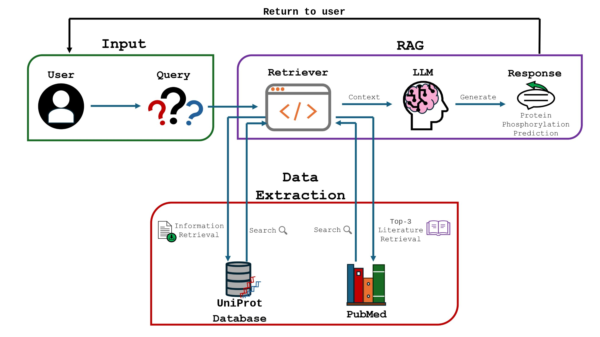
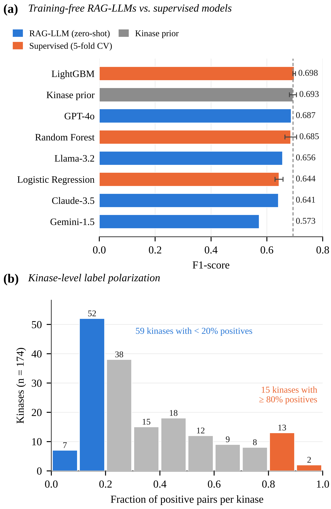
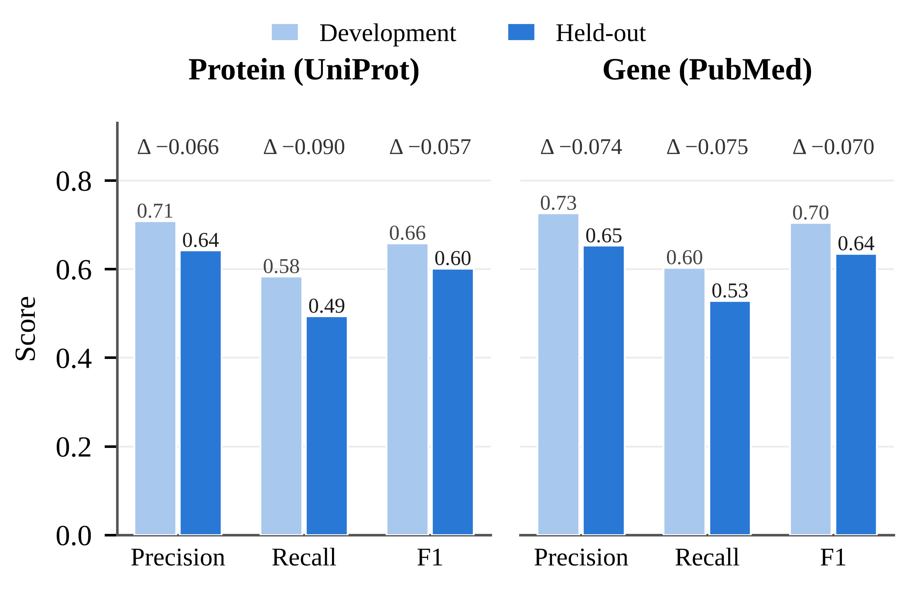

# Training-Free Kinase–Substrate Phosphorylation Prediction with Retrieval-Augmented LLMs

Code, data, and results for the IEEE BIBM 2026 workshop paper:

> **Retrieval-Augmented Large Language Models Enable Training-Free Kinase–Substrate Phosphorylation Prediction from Protein Databases and Biomedical Literature**
> Muhammad Azam, ABC, Zhongming Zhao\*
> Center for Precision Health, McWilliams School of Biomedical Informatics, The University of Texas Health Science Center at Houston, Houston, TX, USA
> \*Corresponding author



---

## Overview

The framework decides whether a **kinase phosphorylates a substrate** without any task-specific training. For each kinase–substrate pair it does three things:

1. **Protein database retrieval.** It queries the [UniProt REST API](https://rest.uniprot.org) for each protein's curated FUNCTION annotation, recommended name and primary gene symbol.
   - Kinase short names (e.g., CDC2, Erk2, PKACa) are mapped to official gene symbols. This uses UniProt gene search plus a manually curated alias table of 76 entries.
2. **Literature retrieval.** It searches PubMed through NCBI Entrez for each gene symbol: ESearch with relevance ranking and up to 10 IDs, then EFetch.
   - Records without an abstract are skipped, and the **top 3 abstracts** per protein are kept.
   - In total this gives 3,312 abstracts.
3. **LLM decision.** It prompts an LLM with the retrieved evidence to answer **"Yes"** or **"No"**.
   - Decoding is greedy, with at most 3 new tokens.
   - The answer is parsed to 1 or 0.

---

## Benchmark

`data/combined_with_label.csv` contains **2,219 kinase–substrate pairs**:

- 1,047 positive and 1,172 negative pairs
- **914 substrates** and **193 kinases**
- median substrate length 603 aa; median kinase-domain length 262 aa

| Column | Description |
|---|---|
| `Uniprotid` | substrate UniProt accession |
| `Sequence` | full substrate sequence |
| `kinase` | kinase short name |
| `kinase_sequence` | full kinase sequence |
| `Kinase Domain` | kinase catalytic domain sequence |
| `label` | 1 = kinase phosphorylates substrate, 0 = does not |

`data/retrieved_pubmed_abstracts.csv` holds the top-3 PubMed abstracts retrieved for every kinase (`Kin_abs1–3`) and substrate (`Sub_abs1–3`).

---

## Results

### Kinase–substrate phosphorylation prediction (2,219 pairs)

| Model | Setting | Precision | Recall | F1 | MCC | AUROC |
|---|---|---|---|---|---|---|
| **GPT-4o** | RAG, training-free | **0.749** | 0.635 | 0.687 | — | — |
| Llama-3.2 | RAG, training-free (local NVIDIA GPU) | 0.701 | 0.616 | 0.656 | — | — |
| Claude-3.5 | RAG, training-free | 0.695 | 0.595 | 0.641 | — | — |
| Gemini-1.5 | RAG, training-free | 0.651 | 0.510 | 0.573 | — | — |
| **LightGBM** | supervised, 5-fold CV | 0.711 | 0.685 | **0.698 ± 0.004** | 0.438 | 0.753 |
| Random forest | supervised, 5-fold CV | 0.735 | 0.642 | 0.685 ± 0.021 | **0.442** | **0.758** |
| Logistic regression | supervised, 5-fold CV | 0.617 | 0.672 | 0.644 ± 0.014 | 0.299 | 0.692 |
| Kinase prior | reference | 0.694 | **0.692** | 0.693 ± 0.012 | 0.420 | 0.741 |

- **Supervised models** use five-fold `StratifiedGroupKFold` grouped by substrate (seed 42), so no substrate appears in both training and test folds.
  - Features: amino-acid and dipeptide composition of the substrate and kinase domain (840 features).
  - Metrics are computed on pooled out-of-fold predictions; ± is the s.d. across folds.
- **Kinase prior** scores each pair by its kinase's training positive rate and ignores the substrate.
- MCC and AUROC are not available for the binary LLM outputs.

### Key findings

- **Training-free RAG vs. supervised models.** Without training, GPT-4o (F1 0.687) comes within 0.011 of the best supervised model and has the highest precision of all models.
- **Kinase-level label polarization.** The substrate-agnostic kinase prior reaches F1 0.693. Of the 174 kinases with at least five pairs, 59 have fewer than 20% positive pairs and 15 have at least 80%. Kinase-aware evaluation is therefore essential for this task.
- **Context source.** PubMed (gene-centric) context outperforms UniProt (protein-centric) context.



### Performance by context source

| Context / subset | Precision | Recall | F1 |
|---|---|---|---|
| Protein (UniProt), development | 0.709 | 0.584 | 0.659 |
| Protein (UniProt), held-out | 0.643 | 0.494 | 0.602 |
| Gene (PubMed), development | 0.726 | 0.604 | 0.705 |
| Gene (PubMed), held-out | 0.653 | 0.529 | 0.635 |



---

## Repository structure

```
rag/
├── notebooks/
│   ├── 01_uniprot_protein_database_retrieval.ipynb   # UniProt REST: FUNCTION, name, gene
│   ├── 02_pubmed_literature_retrieval.ipynb          # Entrez ESearch/EFetch, top-3 abstracts
│   ├── 03_llm_prediction_uniprot_context.ipynb       # LLM Yes/No with UniProt context
│   └── 04_llm_prediction_pubmed_context.ipynb        # LLM Yes/No with PubMed context
├── data/
│   ├── combined_with_label.csv                       # 2,219-pair benchmark
│   └── retrieved_pubmed_abstracts.csv                # top-3 abstracts per kinase/substrate
├── baselines/
│   └── baselines.py                                  # logistic regression, random forest, LightGBM, kinase prior
├── results/
│   ├── llm_results.csv
│   ├── baseline_results.csv
│   ├── baseline_oof_predictions.csv
│   ├── context_source_results.csv
│   └── cv_info.json
├── scripts/
│   └── make_figures.py                               # regenerates Figs. 2–3
├── figures/
├── requirements.txt
├── CITATION.cff
└── LICENSE
```

---

## Reproduce

```bash
git clone https://github.com/Muh-aza/rag.git
cd rag
pip install -r requirements.txt

python baselines/baselines.py     # supervised baselines + kinase prior -> results/
python scripts/make_figures.py    # Figs. 2 and 3 -> figures/
```

**LLM notebooks** (`notebooks/03_*`, `04_*`):
- Run on a CUDA (NVIDIA) GPU, for example Google Colab.
- Need a Hugging Face access token, set as the `HF_TOKEN` environment variable or a Colab secret.
- **Never paste a token into a notebook.**

---

## Citation

```bibtex
@inproceedings{azam2026ragkinase,
  title     = {Retrieval-Augmented Large Language Models Enable Training-Free Kinase--Substrate
               Phosphorylation Prediction from Protein Databases and Biomedical Literature},
  author    = {Azam, Muhammad and ABC and Zhao, Zhongming},
  booktitle = {Proc. IEEE Int. Conf. Bioinformatics and Biomedicine (BIBM)},
  year      = {2026}
}
```

## License

Released under the MIT License (see `LICENSE`).

## Contact

Muhammad Azam — Muhammad.Azam@uth.tmc.edu
Zhongming Zhao — Zhongming.Zhao@uth.tmc.edu
